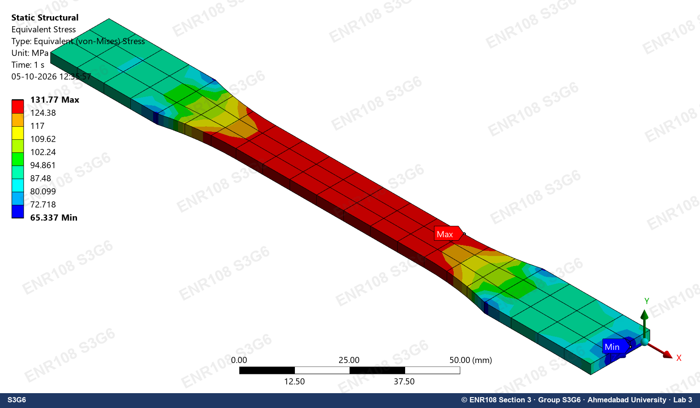
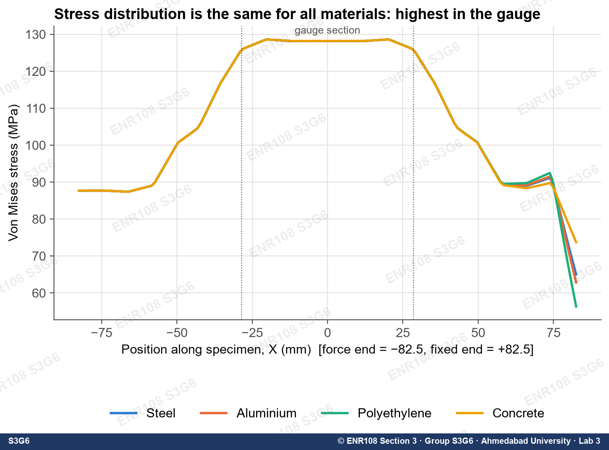
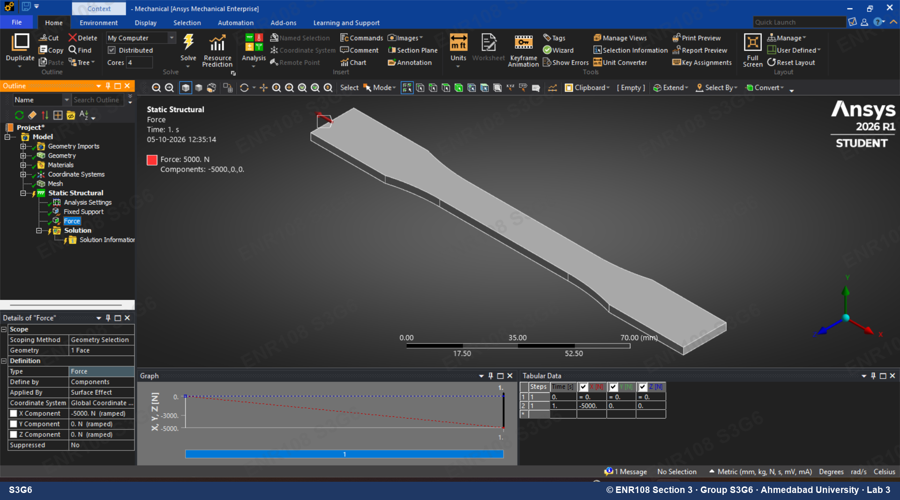
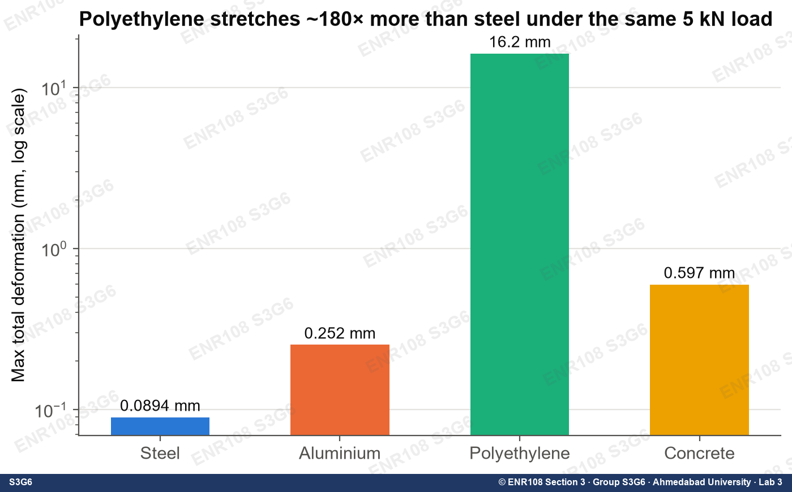
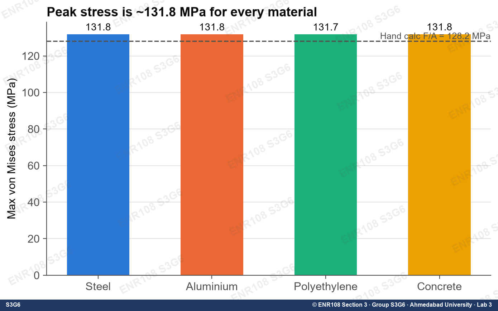
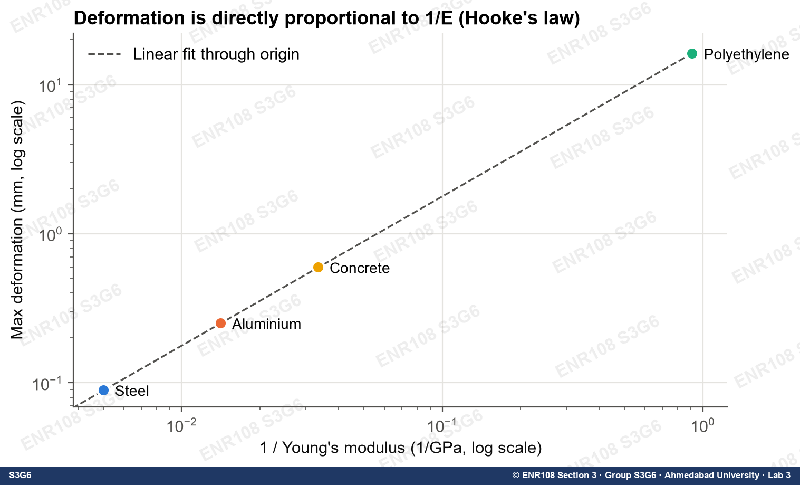
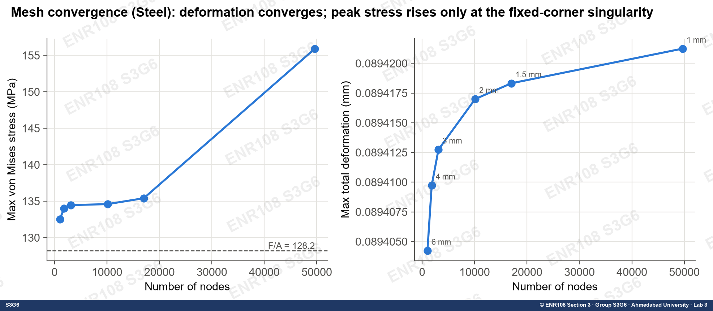
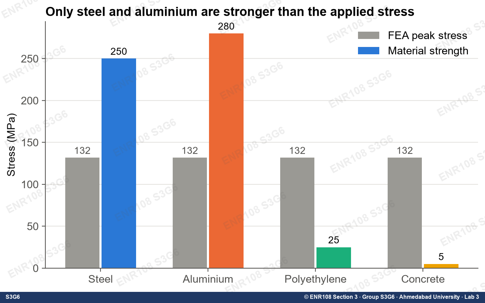
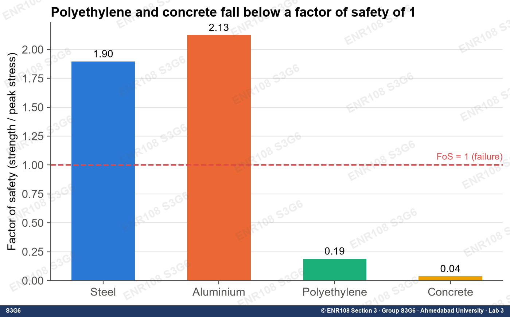

# Tensile Test Simulation in ANSYS Mechanical

Finite element simulation of a standard dog-bone tensile specimen pulled with **5 kN**, solved in
**ANSYS Mechanical (Static Structural)** for four materials: **Structural Steel, Aluminium Alloy,
Polyethylene and Concrete**. The whole analysis is scripted end to end, from geometry import through
meshing, loads, solving and result export to graphs and an Excel workbook. Results are checked
against hand calculations and a mesh-convergence study.

> **Main finding:** peak von Mises stress is the same (≈ 131.8 MPa) for every material, because
> stress depends on load and cross-section, not on the material. Deformation scales with 1/E:
> polyethylene stretches ~180× more than steel. Only steel and aluminium can carry this load
> (factor of safety > 1).

<p align="center">
  
  
</p>

---

## Contents
- [Problem set-up](#problem-set-up)
- [Results](#results)
- [Validation](#validation)
- [Mesh convergence](#mesh-convergence)
- [Discussion](#discussion)
- [Reproducing the analysis](#reproducing-the-analysis)
- [Repository structure](#repository-structure)
- [Assumptions and limitations](#assumptions-and-limitations)
- [Credits](#credits)

---

## Problem set-up

| Item | Value |
|---|---|
| Software | ANSYS Student 2026 R1, Workbench + Mechanical, Static Structural (linear) |
| Geometry | Flat dog-bone, 165 mm long, 3 mm thick, grip width 19 mm, gauge width 13 mm ([`geometry/tensile_specimen.igs`](geometry/tensile_specimen.igs)) |
| Gauge cross-section | 13 × 3 = **39 mm²** |
| Fixed support | End face at X = +82.5 mm |
| Load | Force on end face at X = −82.5 mm, components (−5000, 0, 0) N, which puts the specimen in tension |
| Mesh (main runs) | Program-controlled default: 564 nodes, 63 elements |
| Results extracted | Total deformation, equivalent elastic strain, equivalent (von Mises) stress, directional deformation X, normal stress X, reaction force, and centre-line path distributions |

**Material properties** (ANSYS *General Materials* library):

| Material | E (GPa) | ν | Density (kg/m³) | Tensile yield (MPa) | Tensile ultimate (MPa) |
|---|---|---|---|---|---|
| Structural Steel | 200 | 0.30 | 7850 | 250 | 460 |
| Aluminium Alloy | 71 | 0.33 | 2770 | 280 | 310 |
| Polyethylene | 1.1 | 0.42 | 950 | 25 | 33 |
| Concrete | 30 | 0.18 | 2300 | n/a (brittle) | 5 (compressive 41) |

<p align="center">
  
</p>

---

## Results

| Material | Max total deformation (mm) | Max equivalent strain (mm/mm) | Max von Mises stress (MPa) | Reaction force X (N) |
|---|---|---|---|---|
| Structural Steel | 0.0894 | 6.59 × 10⁻⁴ | 131.77 | 5000 |
| Aluminium Alloy | 0.2517 | 1.856 × 10⁻³ | 131.76 | 5000 |
| Concrete | 0.5966 | 4.393 × 10⁻³ | 131.79 | 5000 |
| Polyethylene | 16.227 | 0.1198 | 131.74 | 5000 |

The reaction force equals the applied 5000 N in every run, so each model is in equilibrium.

<p align="center">
  
  
</p>

**Contour patterns (same for all four materials):**
- Deformation rises from zero at the fixed end to a maximum at the loaded end.
- Stress is uniform (≈ 128–132 MPa) along the gauge section. It drops to ≈ 88 MPa in the grips (5000 N / 57 mm²).
- Peak stress sits where the fillet meets the gauge section (stress concentration).

All contour plots are in [`results/contours/`](results/contours) and all 12 graphs in [`results/graphs/`](results/graphs).

---

## Validation

Hand calculations from simple bar theory:

- Gauge stress: σ = F / A = 5000 / 39 = **128.2 MPa**
- Strain: ε = σ / E
- Elongation, treating the specimen as segments in series: ΔL = (F / E) · Σ(Lᵢ / Aᵢ), with Σ(L/A) = 65.71/57 + 42.2/48 + 57/39 = 3.494 mm⁻¹

| Material | ΔL hand (mm) | ΔL ANSYS (mm) | Difference |
|---|---|---|---|
| Structural Steel | 0.0873 | 0.0894 | 2.4 % |
| Aluminium Alloy | 0.2460 | 0.2517 | 2.3 % |
| Concrete | 0.5823 | 0.5966 | 2.5 % |
| Polyethylene | 15.880 | 16.227 | 2.2 % |

Peak stress: 131.8 MPa from ANSYS vs 128.2 MPa by hand (+2.8 %). The small excess comes from stress
concentration at the fillet, which F/A ignores, and from the coarse default mesh.

<p align="center"></p>

---

## Mesh convergence

Structural Steel re-solved with a uniform body sizing:

| Element size | Nodes | Elements | Max deformation (mm) | Max von Mises (MPa) |
|---|---|---|---|---|
| Default | 564 | 63 | 0.08940 | 131.77 |
| 6 mm | 1 013 | 120 | 0.08940 | 132.53 |
| 4 mm | 1 828 | 225 | 0.08941 | 133.99 |
| 3 mm | 3 116 | 399 | 0.08941 | 134.46 |
| 2 mm | 10 115 | 1 700 | 0.08942 | 134.60 |
| 1.5 mm | 17 021 | 2 912 | 0.08942 | 135.41 |
| 1 mm | 49 648 | 9 519 | 0.08942 | 155.92 |

Deformation converges to within 0.02 %. The jump in *peak* stress at 1 mm happens at a corner of the
fixed face. There the ideal fixed support blocks Poisson contraction and creates a **stress singularity**,
which grows with refinement and is not physical. The gauge-section stress stays at ≈ 128–131 MPa.

<p align="center"></p>

---

## Discussion

- **Stress is material-independent.** The bar is statically determinate, so all 5000 N passes through every cross-section and σ = F/A whatever the stiffness.
- **Deformation and strain ∝ 1/E.** Relative to steel, aluminium deforms 2.8× more (200/71), concrete 6.7× (200/30) and polyethylene ≈ 180× (200/1.1).
- **Strength check.** Factor of safety = strength / 131.8 MPa:

  | Material | Strength used (MPa) | Factor of safety | Outcome |
  |---|---|---|---|
  | Aluminium Alloy | 280 (yield) | 2.13 | Elastic, safe |
  | Structural Steel | 250 (yield) | 1.90 | Elastic, safe |
  | Polyethylene | 25 (yield) | 0.19 | Would yield |
  | Concrete | 5 (tensile ultimate) | 0.04 | Would crack |

<p align="center">
  
  
</p>

---

## Reproducing the analysis

**Requirements**
- Windows with ANSYS 2026 R1 (the free Student edition works); other releases need `-AnsysRoot`
- Python 3.10+ with `pip install -r requirements.txt`

**1. Run the simulation** (about 10 minutes; ANSYS opens visibly, so don't touch its window):

```powershell
powershell -ExecutionPolicy Bypass -File scripts\run_simulation.ps1
# non-student install:
powershell -ExecutionPolicy Bypass -File scripts\run_simulation.ps1 -AnsysRoot "C:\Program Files\ANSYS Inc\v261"
```

This builds the Workbench project in `ansys_project/` and writes the numeric results to `data/raw/`.
It also saves raw contour plots and GUI screenshots to `data/contours_raw/` and `data/screenshots_raw/`.

**2. Build graphs, Excel workbook and watermarked images:**

```bash
python scripts/postprocess.py
```

To change the load or the material list, edit `step_force()` and `MATERIALS` in
[`scripts/mechanical_steps.py`](scripts/mechanical_steps.py). Any material you add must also be
imported in [`scripts/workbench_journal.py`](scripts/workbench_journal.py).

> **Tip:** if Workbench opens with an empty grey window, the Project Schematic is hidden.
> Use **View → Reset Workspace** to bring it back.

---

## Repository structure

```
├── geometry/
│   └── tensile_specimen.igs        # dog-bone CAD model (IGES, mm)
├── scripts/
│   ├── run_simulation.ps1          # one-command launcher (Windows)
│   ├── workbench_journal.py        # Workbench journal: system, materials, geometry, drives Mechanical
│   ├── mechanical_steps.py         # Mechanical steps: mesh, BCs, results, solve, export, convergence
│   ├── screenshot_watcher.ps1      # captures the ANSYS window at each step
│   └── postprocess.py              # graphs, Excel workbook, watermarking
├── data/raw/
│   ├── result_1..4.json            # per-material results (steel, aluminium, polyethylene, concrete)
│   ├── convergence.json            # mesh-convergence study
│   └── paths/                      # stress/strain/deformation along the centre-line, per material
└── results/
    ├── tensile_results.xlsx        # inputs, results, hand-calc formulas, distributions, charts
    ├── graphs/                     # 12 comparison graphs
    ├── contours/                   # ANSYS contour plots for every material
    └── screenshots/                # ANSYS GUI at each step
```

---

## Assumptions and limitations

- Linear-elastic, isotropic, homogeneous materials with small deformations and a static load. Yielding, necking and fracture are **not** modelled. For polyethylene and concrete, the reported values only show that the load exceeds their strength.
- The fixed support is ideal (fully rigid). This causes the stress singularity at its corners.
- Grip, fillet and gauge lengths used in the hand calculation were taken from the CAD face areas. The fillet is approximated by its average width (16 mm).
- The main material comparison uses the default mesh. Deformation is mesh-independent, and the gauge stress changes by < 3 % with refinement.

---

## Credits

Completed for **ENR108 – Materials and the Engineering World**, Ahmedabad University (Monsoon 2026),
Section 3, Group S3G6. The simulation and automation were done by
[Dhairya Sanathara](https://github.com/DhairyaSanathara). The specimen geometry was provided as course material.

Code is released under the MIT License. Results, figures and data are © 2026 ENR108 Group S3G6, all rights
reserved; see [LICENSE](LICENSE).
